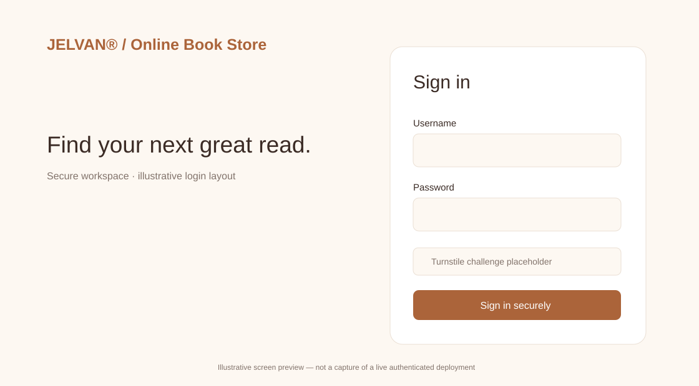
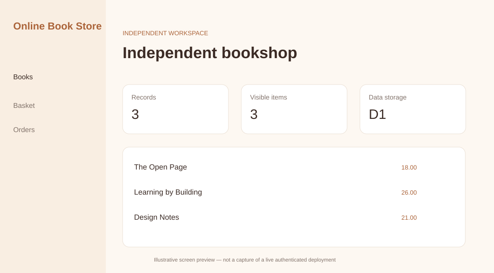

## New login and protected dashboard source — 21 October 2026

These are **new independent showcase screens**, not the original/client product or a verified production release. The images below are vector **illustrative previews**, not live-session screenshots.





**Source features:** Book search and catalog; demo basket and order records; per-user D1 persistence; account administration; server-gated login and admin interface, Turnstile verification and scoped D1-backed session/workspace foundation.

**Not implemented:** No real payment processing, stock reservation, tax, addresses, shipping or order fulfillment.

See [security implementation, deployment and acceptance checklist](docs/APP_SECURITY_AND_SETUP.md) and [database schema](schema.sql). Requires Cloudflare staging configuration and security verification before serving real accounts.

---

# Online Book Store — public portfolio showcase

## Technical documentation (current audit)

**Audit date:** 20 October 2026 · **Release classification:** not a verified complete production application.

**Current GitHub state:** Documentation only; a separately written sample bookshop UI is not in this repo.

**Source/stack evidence:** No canonical original bookstore source was verified. Book catalogs, payments, orders and fulfillment are planned and not production-tested.

**Cloudflare state:** The Pages project hosts an earlier documentation deployment. A site-specific Turnstile widget and a shared `AUTH_DB` D1 binding have been provisioned, but a working application deployment and admin sign-in have not been verified. Secret values must never be committed to this public repository.

**Engineering documentation:**

- **[Complete architecture, folder tree, languages, API contracts and backend connections](docs/TECHNICAL_REFERENCE.md)**
- **[Features, actual implementation status and acceptance requirements](docs/FEATURE_AND_RELEASE_MATRIX.md)**
- **[Authentication, Turnstile, security controls, deployment and operations runbook](docs/SECURITY_AND_OPERATIONS.md)**
- [Source verification and NDA boundaries](docs/SOURCE_VERIFICATION.md)
- [Existing platform/device support notes](docs/DEVICE_PREVIEW.md)

All projects use the portfolio credit **[Developed and Designed by Jelvan®](https://portfolio.jelvan.pro)** for independently authored public work. This does not transfer ownership of third-party/client deliverables.

---


**Bookshop concept and public portfolio case study**  
**Curated by Jelvan R. · Public documentation, not the original source repository.**

> [!IMPORTANT]
> **Independent public portfolio adaptation — confidentiality and attribution**
>
> This repository is a **revised, selectively documented portfolio presentation** independently prepared and maintained by **Jelvan R.** Certain past projects or engagements may be subject to confidentiality, nondisclosure, contractual, intellectual-property, or client-security obligations. To respect those obligations, this public presentation may anonymize, simplify, recreate, omit, or update parts of the original work. **It is not an exact copy, complete implementation, production configuration, or authoritative description of any client system.**
>
> This showcase is **not an official publication of, sponsored by, endorsed by, or affiliated with any current or former client, employer, company, or other development organization**. References to third-party products, technologies, or historical project terminology are for identification only. This notice does **not** claim exclusive ownership of client deliverables, third-party components, trademarks, or intellectual property.
>
> **No confidential source code, credentials, client data, internal hostnames, or production access are provided.** Features and deployment claims must be read with the project-specific verification notes below.


## Overview

A proposed portfolio representation for an online bookstore. Functional requirements are documented without asserting that the original system contains them.

## Current evidence and status

**No matching original source repository was positively verified in connected GitHub accounts; all product features below are illustrative scope, NOT confirmed implementations.**

This repository is **documentation-only**: it does not include an application build, genuine account access, production dependencies or a deployment artifact.

### What the source documentation supports

- No source repository mapping could be authenticated from the available connected repositories.
- No payment integration, deployed URL, or security posture is confirmed.

### Technology context

- Implementation stack not verified
- Technology selection pending source audit

### Capabilities described or proposed

- Illustrative catalog/list/search experience — not yet verified
- Illustrative book detail and cart flow — not yet verified
- Illustrative checkout and order handling — not yet verified

> **Accuracy rule:** Any item identified as illustrative, proposed, unverified, or source-documented must not be marketed as a live, completed feature.

## Architecture at a glance

```text
Proposed: Browser → catalog → cart → checkout adapter → backend; validate against actual source before presenting as implemented
```

For component boundaries, implementation caveats and verification: [Architecture](docs/ARCHITECTURE.md) and [Implementation Notes](docs/IMPLEMENTATION.md).

## Device previews

The portfolio can offer macOS, Desktop Web, iOS and Android **presentation modes**. That does not imply a native build exists on every platform.

| Viewer mode | Evidence-backed display type |
| --- | --- |
| macos | screenshot-placeholder |
| web | screenshot-placeholder |
| ios | screenshot-placeholder |
| android | screenshot-placeholder |

Read the [device preview policy](docs/DEVICE_PREVIEW.md) before enabling live framing. Public demo assets are intentionally absent until permission and sanitization checks are passed.

## Known limitations

- Never present a suggested feature as shipped.
- Do not connect to real payment processing or publish customer/order records.

## Repository contents

```text
README.md                       Project overview and verification status
DISCLAIMER.md                   Public-view / NDA and attribution notice
SECURITY.md                     Safe disclosure and content-handling policy
CONTRIBUTING.md                 Public contribution boundaries
portfolio.json                  Sanitized metadata for portfolio integration
docs/ARCHITECTURE.md            Architecture and boundaries
docs/IMPLEMENTATION.md          Evidence, components and non-goals
docs/DEVICE_PREVIEW.md          Frame behavior and security policy
docs/DEPLOYMENT.md              Safe showcase publication workflow
docs/TESTING.md                 QA and release gate checklist
docs/SOURCE_VERIFICATION.md     Evidence status without private repo details
docs/CHANGELOG.md               Public documentation changelog
assets/README.md                Sanitized images/screenshot instructions
```

## Start here

1. Review [the disclaimer](DISCLAIMER.md) and [implementation notes](docs/IMPLEMENTATION.md).
2. Replace placeholder screenshots only with approved, anonymized visuals.
3. Confirm platform support, and enable approved public demo links only after independent testing.
4. Publish as a distinct public repository; **never mirror, fork or reveal original private projects**.
5. Add the public showcase URL to the Projects section of [portfolio.jelvan.pro](https://portfolio.jelvan.pro) without making production URLs visible in the viewer.

## Licensing and use

This repository provides public-facing explanatory materials only. **Public visibility is not an open-source license or a grant of rights to confidential or third-party works.** Written permission and applicable rights are needed before reuse. No rights in third-party products, names, interfaces, libraries, or client materials are asserted.

## Contact

For portfolio discussion, use the contact route on [portfolio.jelvan.pro](https://portfolio.jelvan.pro). Do not post confidential information in public issues.
